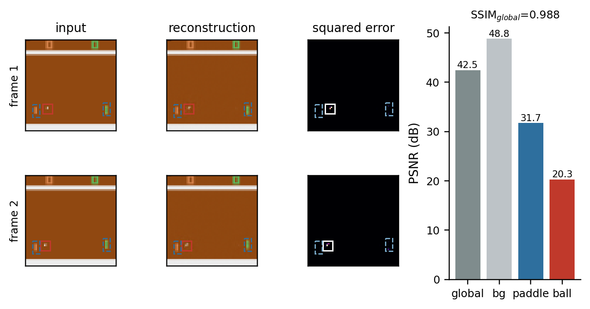

# What DreamerV3 Encodes About Small Objects in Pong

**Steffi Roy** · Khoury College of Computer Sciences, Northeastern University

Does a reconstruction-trained world model actually encode the small, task-critical objects a task depends on? Atari Pong is a sharp test: the paddles are large and high-variance, but the ball, which alone determines reward, covers under one pixel of the 64×64 frame.

This project freezes a short-trained DreamerV3 world model and probes its latent at four depths, regressing ground-truth object positions (from Atari RAM annotations) with ridge and MLP probes under an episode-level split. Reconstruction is treated as a diagnostic rather than a training signal: each object's decodability is measured at each tap against a random-init floor and a pixel-probe ceiling, and reconstruction fidelity is measured globally versus at the ball.

**Headline finding: a split verdict.** Reconstruction is strongly asymmetric (the ball region reconstructs far worse than the frame, with 13.7× the paddle's per-pixel error), while decoding shows only a partial, directional deficit: the ball's horizontal position lags, the vertical one does not.



## Links

| Item | Link |
|---|---|
| Report (PDF) | [report.pdf](report.pdf) |
| Presentation video | https://youtu.be/nNmZyIs8wEs |
| Gameplay clip (25 s) | [figures/pong_agent.mp4](figures/pong_agent.mp4) |

## Results

- **Decoding (held-out R², recurrent state `h_t`):** player 0.99, enemy 0.94, ball_y 0.985, but **ball_x 0.865** against a 0.977 pixel ceiling. An MLP probe lifts ball_x to 0.92 (partly entangled).
- **Reconstruction (test):** global PSNR **42.5 dB** / SSIM 0.988, but the tight ball box reaches only **20.3 dB**, with **13.7×** the paddle's per-pixel error.
- **Methodological control:** the 4096-d encoder embedding `e_t` is uninterpretable as evidence. A random-init encoder already scores R² > 0.97, so all numbers are read against a dimensionality-matched floor.
- **Agent:** greedy return **−14.0 ± 2.4** (random −21; full DreamerV3 ≈ +18). This is a deliberately brief, mid-training agent.

## Repository layout

```
report.pdf                 Final report (IEEE 2-column)
src/                       Pipeline code (training, probing, controls, metrics, figures)
figures/                   Mechanism figure, gameplay filmstrip, gameplay clip
requirements.txt           Python dependencies for the probe pipeline
```

## Setup

- Python 3.10, PyTorch 2.4.1+cu121.
- DreamerV3 via the [NM512 PyTorch reimplementation](https://github.com/NM512/dreamerv3-torch). The scripts expect it at `repos/dreamerv3-torch`:

```bash
git clone https://github.com/NM512/dreamerv3-torch repos/dreamerv3-torch
pip install -r repos/dreamerv3-torch/requirements.txt
pip install -r requirements.txt
```

- Ground-truth object positions come from the AtariARI RAM annotations.

## How to reproduce

```bash
# 0. sanity gate: confirm labels populate before anything else
python src/check_ari.py --steps 600

# 1. train (short, disposable agent)
python src/train_dreamer.py --configs atari100k --task atari_pong \
    --logdir runs/pong_seed0 --seed 0 --steps 2.25e4 --ckpt_every 15000

# 2. build probe dataset (episode-level split)
python src/build_probe_dataset.py --logdir runs/pong_seed0 \
    --checkpoint runs/pong_seed0/checkpoints/<final>.pt \
    --out data/probe_pong_seed0.h5 --episodes 200 --eps 0.3

# 3. extract latents (four taps) + reconstructions
python src/extract_latents.py --data data/probe_pong_seed0.h5 \
    --logdir runs/pong_seed0 --out latents/seed0 --save_recon

# 4. controls (random-init floor + pixel-CNN ceiling)
python src/controls.py --data data/probe_pong_seed0.h5 --logdir runs/pong_seed0 \
    --latents latents/seed0 --random_init 2 --cnn_probe --out results/pixel_cnn_seed0.csv

# 5. probe sweep + reconstruction metrics
python src/run_probes.py --data data/probe_pong_seed0.h5 --latents latents/seed0 \
    --out results/probe_results_seed0.csv
python src/reconstruction_metrics.py --data data/probe_pong_seed0.h5 \
    --latents latents/seed0/<final>.h5 --out results/recon_seed0.csv
```

## Notes and caveats

- Splits are **by episode, never by frame** (adjacent Atari frames are near-duplicates and inflate R²).
- Ball position (0,0) during the serve pause is masked out of ball probes and ball-region reconstruction.
- RAM values are offset from screen coordinates; the reconstruction bounding boxes use calibrated offsets.
- The velocity contrast is weakened by max-pool ghosting (two emulator frames per observation).
- Training was truncated at 22,500 policy steps while ball_x was still improving, so decoding numbers are a lower bound.

## References

- Balestriero & LeCun, "How Learning by Reconstruction Produces Uninformative Features for Perception," ICML 2024.
- Anand et al., "Unsupervised State Representation Learning in Atari" (AtariARI), NeurIPS 2019.
- Hafner et al., "Mastering Diverse Control Tasks through World Models" (DreamerV3), Nature 2025.
- DreamerV3 PyTorch reimplementation: github.com/NM512/dreamerv3-torch
- Delfosse et al., "OCAtari," RLC 2024.
# dreamerv3-pong-probing
